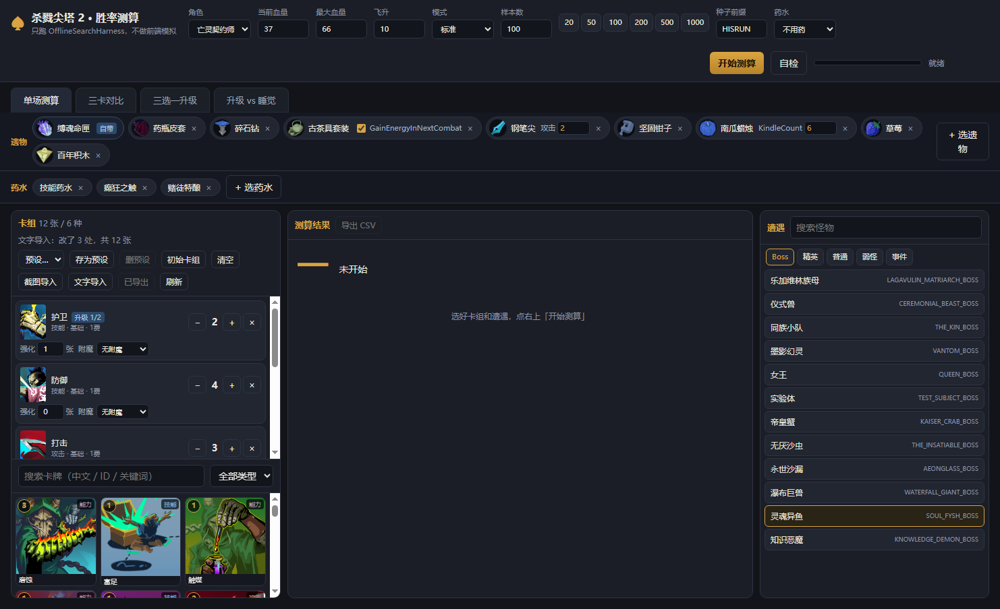
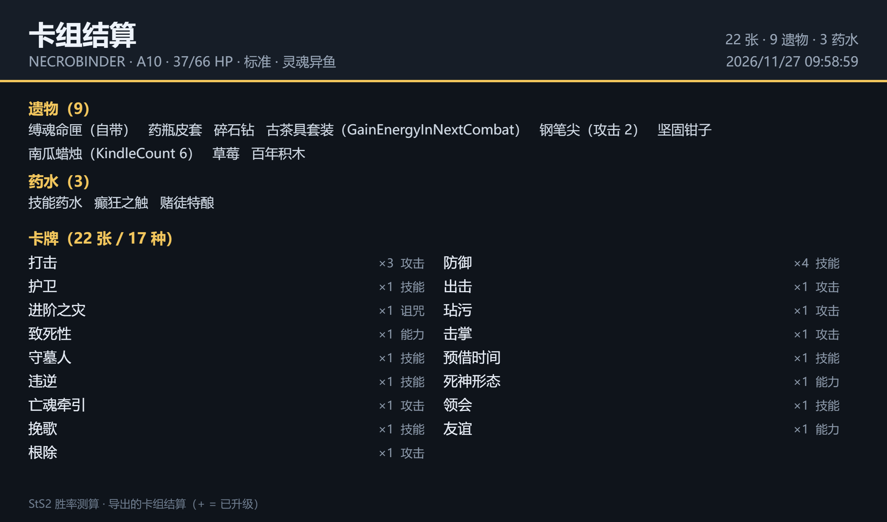

# 杀戮尖塔 2 · 胜率计算器（网页版）

把卡组、遗物、药水、血量和遭遇填进一个本地网页，它**真的把战斗打一遍**（跑很多个种子），
再告诉你胜率、掉血区间和每局战损——不是查表、也不是估算。



**它不含游戏本体，需要你自备正版《杀戮尖塔 2》。** 战斗由开源的
[CombatSolver](https://github.com/Torch1230/CombatSolver)（MIT）的离线求解器
`OfflineSearchHarness` 在本地实机规则下跑出来，这个仓库只是它的**外壳和界面**。



## 能做什么

- **卡组编辑**：按角色从卡库里挑，同名卡分别记「升了几张」「附魔几张」；一键套用初始卡组。
- **文字导入**：一句话在初始卡组上改——`绿护卫，白能量汲取，删一打`（绿=已升级、白=不升级，
  数量写成 `2绿打击`，删除写 `删四防`）。先出预览，认不出的短语单独列出来、不会瞎猜。
- **截图导入**：卡组页/结算页截一张图丢进去，用 Windows 自带 OCR 认出卡名和升级标记，
  你核对一遍再应用（识别不确定的行会标黄、默认不计入）。
- **药水**：最多三瓶，可从全部药水里搜；可重复、可删。
- **遗物计数**：读游戏存档时把遗物计数器（钢笔尖的攻击数、南瓜烛的点燃数……）一起带出来，
  在界面上显示成可改的数字框，测算时按你写的数进模拟。
- **结算图导出**：一键把「这个卡组长什么样」画成 PNG——卡牌（升级标`+`、数量、附魔）+ 遗物 + 药水 + 血量/飞升/模式。
- **三选一升级**：从卡组里点三张，四张卡横着比（「不升级」当基线），直接出「该升哪张」。
- **三卡对比 / 升级 vs 睡觉**：同一批种子下比方案。
- **恐惧模式**：切到恐惧后按首领的领域规则跑（知识恶魔因需要战斗开局二选一，暂不支持）。
- **真读存档**：直接读 `current_run.save`，卡组/遗物/血量/遭遇一次填好。

## 怎么用

### 一、下载打包版（推荐，不用装 Node）

去 [Releases](../../releases) 下 `StS2胜率测算-*.zip`，解压到**普通目录**（别放 `C:\Program Files`），
双击 `启动.cmd`。包里自带 Node 和模拟器，说明书在 `说明书.md`。

前置：**.NET 9 运行时**（[下载](https://dotnet.microsoft.com/download/dotnet/9.0) 选 "Run console apps"）、
游戏 **0.114.0**、创意工坊订阅 **RitsuLib**（id 3747602295）。

### 二、从源码跑

```powershell
# 1. 模拟器：自己构建（MIT，见下）
#    构建产物放到本仓库的 harness\ 下：OfflineSearchHarness.exe + 同目录 dll
# 2. 起服务（需要 Node 20+）
node server.mjs            # 默认 http://127.0.0.1:8766/
```

模拟器怎么来：按 [CombatSolver 的离线搜索宿主文档](https://github.com/Torch1230/CombatSolver/blob/main/docs/OFFLINE_SEARCH_HARNESS.md)
构建 `tools/search/OfflineSearchHarness`——需要 `dotnet build`（.NET 9 SDK）、正版游戏、
RitsuLib，并把 `local.props.example` 复制成 `local.props` 指好 `SteamRoot`/`Sts2Dir`/`RitsuLibDir`。
构建出的 `OfflineSearchHarness.runtimeconfig.json` 要指向你本机的游戏目录和 CombatSolver.dll，
直接照该文档或打包版里的同名文件改。

没有模拟器时网页照样能打开、能编辑卡组，只是**点了测算会报「模拟器启动失败」**。

## 仓库里有什么 / 没什么

```
server.mjs        本地服务：静态页 + /api/import（读存档）+ /api/solve（跑模拟）+ 打包用的自检
public/           前端：index.html / app.js / decklogic.js（卡组与文字解析，可单测）/ style.css
lib/shot.mjs      截图导入（调 Windows OCR）
tools/            pack.ps1（打分发包）、ui-*-check.mjs（无头 Chrome 的界面回归）、build-meta 等
test/             node --test 的单元测试（decklogic 的文字解析、卡组展开）
assets/*.json     卡片/遗物索引、初始卡组、恐惧领域表（从游戏导出，见下）
data/ocr*.ps1     OCR 辅助脚本
pack/说明书-分发包.md   随包发的说明书
```

**不在仓库里**：卡图/遗物图（259MB，MegaCrit 版权）和 `data/eng`、`data/zhs` 的游戏本地化原文。
缺图时界面会显示「无图」占位，不影响功能。想补齐的话，用 `tools/shrink-assets.py` 把你自己
从游戏里取出的卡图缩一份放到 `assets/cards/`、`assets/relics/` 即可。

## 测试

```powershell
node --test test/decklogic.test.mjs      # 14 个用例，纯函数，不需要游戏
node tools/ui-features-check.mjs         # 无头 Chrome 点一遍四种功能（需要 Chrome + 服务在跑）
node tools/relicprops-check.mjs          # 对照实验：遗物计数传 0 / 9 / 不传
```

## 已知限制

- 只支持 **Windows**（OCR 走系统接口，读存档写的是 Windows 路径），游戏版本 **0.114.0**，
  模拟器是本地打过补丁的构建（支持改血量上限、恐惧模式、无头运行），游戏或 mod 更新后需要重编。
- 遗物计数走 harness 请求的 `integerMembers` / `booleanMembers`（反射写进遗物模型）。
  **成员名写错不会忽略，而是整局失败**（`遗物 X 不存在状态成员 Y`），所以界面只传存档里读到的真名字。
- 自带遗物（如缚魂命匣）由模拟器建局时自己加上，不能注入计数，也没有计数。
- 恐惧模式的「知识恶魔」要在战斗开始二选一灾祸，离线没有这个选择器，界面里禁用了。
- 截图导入依赖系统中文 OCR（精简版 Windows 可能没有）。

## 数据与版权

卡名、遗物名、卡牌索引这些数据来自游戏本体，版权归 **MegaCrit**；
本项目不附带游戏图片与本地化原文，仅作为工具索引使用。若要发布你自己的衍生包，
请自行确认游戏 EULA 与 mod 作者的许可。

## 许可

代码 **MIT**，见 [LICENSE](LICENSE)。第三方组件与归属见 [THIRD_PARTY_NOTICES.md](THIRD_PARTY_NOTICES.md)。
